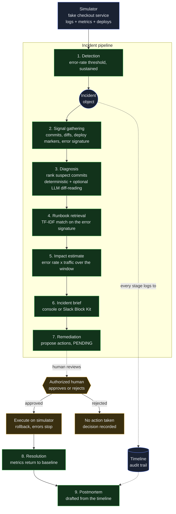

# Bisect

An evidence-first AI incident investigator. When a production service breaks, bisect works out what broke, which commit likely caused it, which runbook applies, and how big the impact is, then posts a clean brief and drafts the postmortem once it is resolved.

It is advisory and human-in-the-loop by design. bisect diagnoses and recommends. A human approves any action that touches the system. It never changes production on its own. The diagnosis quality is the product. The action is the human's judgment call.

## What makes it different

Most incident tooling either stops at "here is a dashboard" or tries to auto-remediate and asks you to trust it. bisect takes a third path. It does the tedious 80 percent of incident response (gathering context, correlating signals, drafting the writeup) so a human can make the 20 percent that needs judgment, quickly and with evidence in front of them.

Two design decisions shape everything:

**Evidence-first.** Correlation, impact math, severity, and the timeline are computed deterministically from real signals: logs, metrics, and real git history. Where a language model is used, it only ranks pre-filtered git diffs and explains its reasoning. It never invents a number that lands in the incident record. Every conclusion is inspectable.

**Measured, not asserted.** bisect is built on a controlled simulator with ground truth. A known-bad commit is planted, so accuracy can actually be measured rather than claimed. The benchmark is a first-class part of the project, not an afterthought.

## Architecture

One event-driven pipeline. An alert fires and the incident walks through nine stages, each reading and writing a single shared `Incident` object.



The single `Incident` object is the contract every stage speaks. When simulated sources are later swapped for real APIs (GitHub, Datadog, Slack), nothing downstream changes, because everything reads the same object.

## How "which commit caused it" works

This is the hardest and most novel part. bisect stacks three cheap signals and reasons over them:

1. **Time correlation.** The error spike starts right after a deploy landed. The closest preceding deploy is the prime suspect. This is the strongest single signal.
2. **Blast radius.** The failing endpoint and the file named in the stack trace map to the files each recent commit touched. A commit that changed the checkout service is a better suspect for checkout errors than one that changed the docs.
3. **Error-signature match.** The exception (`AttributeError: 'NoneType' ... session`) points at the exact code a commit changed.

A deterministic baseline scores commits on these signals. An optional LLM ranker reads the actual diffs and re-ranks with reasoning. The output is a ranked list with confidence and reasoning, not a single guess.

## The benchmark

Because the simulator provides ground truth, bisect measures whether diagnosis ranks the known-bad commit. The hard scenarios plant a benign **decoy** commit that touches the same failing file and deploys closest to the spike, so timing and blast-radius heuristics get fooled and only reading the diff finds the real culprit.

| Mode | Commit top-1 | Commit top-3 | Runbook hit | Latency |
| --- | :---: | :---: | :---: | :---: |
| deterministic baseline | 33% | 100% | 100% | ~190 ms |
| LLM diff-reading | pending | pending | 100% | pending |

The baseline dropping to 33 percent top-1 on the hard set is the result that matters. It shows that service-matching and timing are not enough, and that reading the diff is what closes the gap. The bad commit stays in the top 3 every run, so the ranker's job is to reorder, not to find a needle. The LLM row is wired in and runs the moment an API key is present. It is left as pending rather than reporting a number that has not yet been measured.

Runbook retrieval is measured separately and reaches 100 percent top-1 across the seeded failure types.

## Status

Built on a controlled simulator first. The simulator is what provides the ground truth that makes the benchmark meaningful. Real integrations are the final phase.

- [x] **Phase 0.** Incident schema, the shared contract every stage reads and writes
- [x] **Phase 1.** Simulator that breaks on deploy, plus a real toy git repo with a planted bad commit and a decoy
- [x] **Phase 2.** Detection, fires an alert and creates an incident
- [x] **Phase 3.** Diagnosis agent, deterministic plus optional LLM, with the benchmark
- [x] **Phase 4.** Runbook retrieval, TF-IDF with a clean upgrade path to vector search
- [x] **Phase 5.** Impact estimation
- [x] **Phase 6.** Incident brief, console and Slack
- [x] **Phase 7.** Remediation, human-approved, with an authorization gate and audit trail
- [x] **Phase 8.** Resolution detection and postmortem generation
- [ ] **Phase 9.** Real integrations (GitHub, Datadog or Prometheus, Slack)

The full loop runs end to end today, from a service breaking to a drafted postmortem, in one command.

## Quick start

```bash
python3 -m venv .venv && source .venv/bin/activate
pip install -r requirements.txt

# build the real toy repo (planted bad commit + decoy)
python3 scripts/make_toy_repo.py

# run the full loop: simulate, detect, diagnose, runbook, impact,
# brief, human-approved remediation, resolution, postmortem
python3 scripts/run_demo.py

# measure diagnosis accuracy across easy and hard scenarios
python3 scripts/run_benchmark.py

# check runbook retrieval accuracy
python3 scripts/eval_runbooks.py
```

The LLM ranker and the postmortem polish activate automatically when an `ANTHROPIC_API_KEY` is set. Without one, everything runs on the deterministic path.

## Human-in-the-loop remediation

bisect suggests. It never acts on its own. Every recommended action sits pending until an authorized human explicitly approves it.

1. bisect proposes actions (roll back, open revert PR) on the incident. Nothing runs.
2. The actions sit pending.
3. A human reviews the evidence and approves or rejects.
4. On approval, and only then, the action executes. In the demo a rollback deploys the last known-good build and the error rate drops back to baseline.
5. The decision, the approver, and the result are written to the incident timeline.

The authorization check is real logic, not a stub, even though it runs against a fake roster for now. When this touches anything real, that check is the thing standing between a helpful tool and an AI that changed production. It exists now so it is already there when it matters.

## Repository layout

```
src/core/incident.py        the Incident contract (Phase 0)
src/simulator/              fake service, healthy then deploy then broken (Phase 1)
src/detection/              threshold detector, creates an Incident (Phase 2)
src/diagnosis/              signal gathering and ranking, deterministic and LLM (Phase 3)
src/runbooks/               TF-IDF runbook retrieval (Phase 4)
src/impact/                 impact estimation (Phase 5)
src/slack/                  incident brief, console and Slack notifiers (Phase 6)
src/remediation/            human-approved actions with audit trail (Phase 7)
src/postmortem/             resolution detection and postmortem generation (Phase 8)
data/runbooks/              seven sample runbooks (committed)
scripts/make_toy_repo.py    builds a real git repo with a planted bad commit and decoy
scripts/run_demo.py         one-command full-loop demo
scripts/run_benchmark.py    diagnosis accuracy on easy and hard scenarios
scripts/eval_runbooks.py    runbook retrieval accuracy
```

## Tech

Python, Pydantic for the Incident contract, real git for commit correlation, pure-Python TF-IDF for retrieval, and the Anthropic API for optional diff-reading diagnosis and postmortem polish. No external services are required to run the core. It works offline on a simulator with ground truth.

## Honest scope

This runs on a simulator, by design. The simulator is what provides the ground truth that makes the benchmark meaningful. Real data-source integrations (GitHub, Datadog or Prometheus, Slack) are Phase 9. Everything downstream reads one Incident object, so swapping simulated sources for real APIs is a contained change, not a rewrite.
